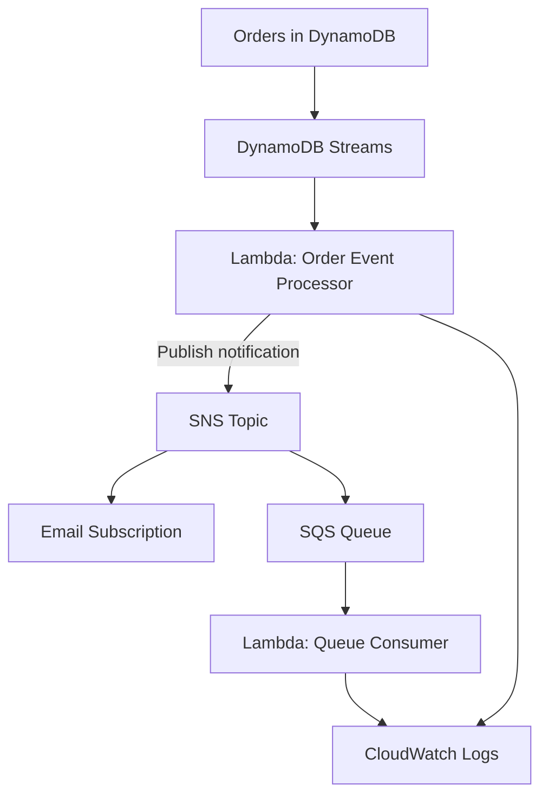

# AWS Event-Driven Data Ingestion Pipeline

## 1. Project Overview

This project implements an event-driven e-commerce order ingestion pipeline using AWS services and Python. It captures order events, stores them in Amazon DynamoDB, processes database changes with AWS Lambda, and distributes notifications through Amazon SNS and Amazon SQS.

The project demonstrates cloud-based data ingestion, event-driven processing, asynchronous messaging, and operational monitoring.

**Project Status:** Core pipeline implemented and tested; reliability enhancements planned.

## 2. Business Problem

E-commerce applications generate order events continuously. Processing every event synchronously can increase response times and make systems harder to scale.

This project uses event-driven architecture to decouple order storage, event processing, notifications, and queue-based consumption. This allows services to process events independently and supports asynchronous workflows.

## 3. Project Objectives

- Store e-commerce order records in Amazon DynamoDB.
- Capture table changes using DynamoDB Streams.
- Process events automatically using AWS Lambda.
- Publish order notifications through Amazon SNS.
- Buffer notifications in Amazon SQS.
- Monitor processing activity using Amazon CloudWatch.
- Handle different message formats, including JSON and plain-text SNS notifications.
- Track code and documentation using Git and GitHub.
- Extend reliability with idempotency, retries, and a dead-letter queue.

## 4. Technologies Used

| Technology | Purpose |
|---|---|
| Python | Lambda event processing and message parsing |
| Amazon DynamoDB | Stores order records |
| DynamoDB Streams | Captures database changes |
| AWS Lambda | Processes stream and queue events |
| Amazon SNS | Publishes order notifications |
| Amazon SQS | Buffers messages for asynchronous processing |
| Amazon CloudWatch | Stores execution logs and errors |
| AWS IAM | Controls service permissions |
| Git and GitHub | Version control and project documentation |

## 5. Architecture and Workflow

The implemented workflow is:

1. **Order storage:** New order records are inserted into the DynamoDB `Orders` table.
2. **Change capture:** DynamoDB Streams captures table changes.
3. **Stream processing:** The `process-order-events-python` Lambda function processes new `INSERT` records.
4. **Notification publishing:** Lambda publishes order details to the `order-notifications` SNS topic.
5. **Notification delivery:** SNS distributes notifications to a confirmed email subscription and the configured SQS queue.
6. **Queue processing:** Lambda consumes SQS messages and logs the order or notification details.
7. **Monitoring:** CloudWatch Logs records successful processing and runtime errors.

### Architecture diagram



**Important implementation detail:** The same Lambda function handles both DynamoDB stream records and SQS records. For DynamoDB `INSERT` events, it publishes an SNS notification. For SQS events, it processes and logs the message without publishing it back to SNS, avoiding a notification loop.

## 6. Sample Order Event

```json
{
  "event_id": "evt-1004",
  "event_type": "ORDER_CREATED",
  "order_id": "ORD-1004",
  "customer_id": "CUST-104",
  "product_id": "PROD-504",
  "quantity": 2,
  "amount": 1200,
  "status": "CREATED"
}
```

The `event_id` identifies the event, while `order_id` identifies the business order. These identifiers can support duplicate-event detection in a future idempotency implementation.

## 7. Project Structure

```text
aws-event-driven-ingestion/
├── .gitignore
├── README.md
├── src/
│   └── producer.py
├── events/
│   └── sample_order.json
├── tests/
└── docs/
```

- `src/producer.py` — Initial local Python producer.
- `events/sample_order.json` — Sample order event.
- `tests/` — Directory for automated tests.
- `docs/` — Directory for architecture and implementation documentation.
- `.gitignore` — Excludes local and unnecessary files.
- `README.md` — Project overview and implementation guide.

The structure above reflects the intended local repository layout; ensure the files and directories exist in GitHub before treating every entry as implemented.

## 8. Implementation and Validation

### Completed

- Created the initial local project structure and sample order event.
- Initialized Git and pushed the project to GitHub.
- Created the DynamoDB `Orders` table and enabled DynamoDB Streams.
- Configured the Lambda function `process-order-events-python`.
- Configured the SNS topic `order-notifications` and confirmed its email subscription.
- Created the SQS queue `order-processing-queue` and configured SNS delivery to it.
- Enabled DynamoDB Streams and SQS event source mappings for Lambda.
- Configured the Lambda SNS topic ARN using an environment variable.
- Fixed a Lambda handler configuration issue and JSON parsing errors.
- Verified that DynamoDB order `ORD-1004` triggered Lambda and resulted in an SNS publish.
- Verified that an SQS message was processed successfully, with order details recorded in CloudWatch Logs.

### Planned reliability improvements

- Add a dead-letter queue for messages that repeatedly fail processing.
- Implement idempotency to handle duplicate event deliveries safely.
- Add input validation and automated tests.
- Configure CloudWatch alarms and operational dashboards.
- Document deployment and cleanup procedures.

## 9. Reliability, Security, and Cost Awareness

- Use IAM roles and permissions appropriate to each service.
- Keep credentials and secrets out of source control.
- Validate required order fields and message formats.
- Account for duplicate delivery and retry behavior.
- Monitor Lambda failures and SQS queue backlogs.
- Configure suitable log retention to control storage costs.
- Review AWS resources and costs regularly.

**Current limitation:** A dedicated dead-letter queue, full idempotency controls, and comprehensive alarms have not yet been verified as implemented.

## 10. Running the Local Demo

Prerequisite: Python must be installed and available through the Windows Python launcher.

From the project root, run:

```powershell
py src/producer.py
```

The initial local program is a standalone demo. It does not itself write to DynamoDB unless you extend it with AWS SDK integration.

## 11. Future Enhancements

- Integrate the Python producer with DynamoDB using Boto3.
- Add schema validation and automated unit and integration tests.
- Configure a dead-letter queue and retry strategy.
- Implement idempotent processing.
- Add CloudWatch alarms and performance metrics.
- Deliver processed order data to an analytics destination such as Amazon S3.
- Automate deployment using AWS SAM or AWS CloudFormation.

## 12. Repository

GitHub: https://github.com/Erantikarthik/aws-event-driven-ingestion

## 13. Learning Outcomes

This project demonstrates practical work with:

- Event-driven architecture and serverless processing.
- DynamoDB change data capture using Streams.
- Asynchronous messaging with SNS and SQS.
- Python event handling and JSON parsing.
- CloudWatch logging and error investigation.
- IAM permissions and cloud cost awareness.
- Git-based version control and technical documentation.
